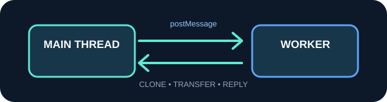

<div align="center">


[](LICENSE)

[](https://github.com/CyberLoop-dev/web-worker-message-lab/stargazers)




</div>

## 🧭 Overview
A local browser lab for dedicated Web Workers. Send structured objects, transfer an `ArrayBuffer`, and observe message order, worker errors, and termination.

## ✨ Features
- 📨 Send nested objects through `postMessage()`.
- 🔁 Transfer an `ArrayBuffer` and observe the sender's detached buffer.
- 🔢 Queue ordered messages and inspect their replies.
- ⏹️ Restart or terminate the Worker.
- 🔒 All examples run inside the browser; nothing is uploaded.

## 🖥️ Demo
Run the local Node.js server; no hosted demo is configured.

## 🚀 Quick Start
```bash
npm start
```
Open `http://127.0.0.1:4175`.

## 🧰 Tech Stack
- Node.js built-in HTTP server
- Dedicated Web Workers
- Structured Clone Algorithm and Transferable Objects
- Vanilla JavaScript, HTML, and CSS

## 🗂️ Folder Structure
```text
.
├── assets/mark.svg
├── public/app.js
├── public/index.html
├── public/styles.css
├── public/worker.js
├── package.json
├── server.js
└── README.md
```

## 🗺️ Roadmap
- [ ] Add a SharedWorker comparison.
- [ ] Demonstrate messageerror with an unsupported payload.
- [ ] Add a small transferable typed-array exercise.

## 🤝 Contributing
Keep examples deterministic and document which data is cloned versus transferred.

## 📄 License
MIT. See [LICENSE](LICENSE).

<div align="center">


</div>
